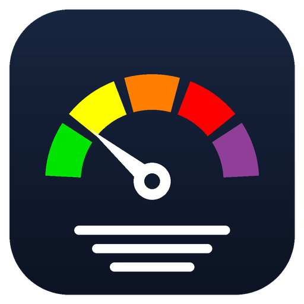

<p align="center"></p>

# aqi-tray

Live air quality as a colour-coded number in the Windows system tray, next to the clock.

It takes the median PM2.5 reading from [Sensor.community](https://sensor.community) citizen sensors around a point you choose, converts it to the US EPA AQI (2024 breakpoints) and refreshes every 15 minutes. No API key, no account.

| AQI | Colour | Level |
|---|---|---|
| 0–50 | green | Good |
| 51–100 | yellow | Moderate |
| 101–150 | orange | Unhealthy for sensitive groups |
| 151–200 | red | Unhealthy |
| 201–300 | purple | Very unhealthy |
| 301+ | maroon | Hazardous |

Hover for PM2.5 in µg/m³, sensor count and update time. Double-click opens the sensor map; right-click for **Refresh now**, **Change location…** and **Quit**.

When AQI reaches 101 ("Unhealthy for sensitive groups", PM2.5 above 35.4 µg/m³), you get a Windows notification to close the windows and turn on the air purifier. It fires once per episode and re-arms after AQI drops below 90, so readings hovering around the line don't spam you.

## Install (the easy way)

1. **[Download AQI-Tray-Setup.exe](https://github.com/Satin42/aqi-tray/releases/latest/download/AQI-Tray-Setup.exe)**
2. Double-click it. Windows will probably say **"Windows protected your PC"**, because the app isn't signed with a paid certificate. Click **More info**, then **Run anyway**.
3. Click **Next** and **Install**. Leave "Start automatically when I sign in" ticked if you want it every day.

The number appears next to the clock. If you don't see it, click the **^** arrow by the clock and drag the icon onto the taskbar.

No admin rights or Python needed. To remove it: **Settings → Apps → Installed apps → AQI Tray → Uninstall**.

It starts on central Belgrade; see [Change location](#change-location) for your own neighbourhood.

## Run from source

Requires Python 3.10+ on Windows.

```
pip install -r requirements.txt
pythonw aqi_tray.py
```

## Change location

It starts on central Belgrade. Right-click the number → **Change location…**, type your neighbourhood, street or town (e.g. `Vračar, Belgrade`, `Zemun`, `Novi Sad`) or coordinates like `44.80, 20.47`, and confirm. It searches 3 km around that point and widens to 6 or 10 km if fewer than 3 sensors are nearby. The choice is saved in `%APPDATA%\aqi-tray\config.json` and survives restarts and updates.

Place names are looked up with [OpenStreetMap Nominatim](https://nominatim.org), so whatever you type is sent to it.

## Configure (source)

Other settings are constants at the top of `aqi_tray.py`:

| Constant | Default | Meaning |
|---|---|---|
| `DEFAULTS` | Belgrade centre, 3 km | Location used until you pick one |
| `REFRESH_S` | `900` | Refresh interval in seconds |
| `ALERT_AQI` | `101` | AQI that triggers the purifier notification |
| `ALERT_RESET_AQI` | `90` | AQI the air must drop below before the next alert |

If the icon shows `?`, the sensor API didn't answer; it retries on the next refresh, or use **Refresh now**.

## Start with Windows

In PowerShell, from the repo folder:

```powershell
$s = (New-Object -ComObject WScript.Shell).CreateShortcut("$([Environment]::GetFolderPath('Startup'))\AQI Tray.lnk")
$s.TargetPath = (Get-Command pythonw).Source
$s.Arguments = "`"$PWD\aqi_tray.py`""
$s.WorkingDirectory = "$PWD"
$s.IconLocation = "$PWD\assets\icon.ico"
$s.Save()
```

## Caveats

Sensor.community nodes are low-cost optical sensors (mostly SDS011). They read high in fog and humidity above ~80%, so treat spikes on foggy days with suspicion. The median across many sensors filters out single broken nodes but not weather-wide bias.

## License

MIT
